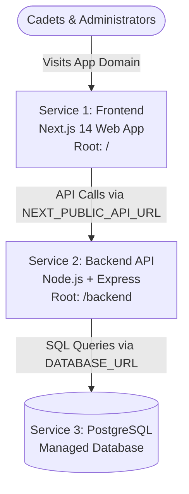

# 🚂 Complete Guide: Host Everything on Railway
### PostgreSQL Database + Node.js Backend + Next.js Frontend in One Railway Project

---

## 🏗️ Architecture on Railway

You will have **3 interconnected services** inside a single Railway Project:



---

## 📌 Prerequisites: Commit & Push Latest Code to GitHub

Open PowerShell in your project and push our latest configuration updates:

```powershell
cd C:\Users\vadar\Downloads\Shivam-Academy-Result-Portal
git add .
git commit -m "Update Railway port binding and CORS for fullstack Railway hosting"
git push origin main
```

---

## 🚀 STEP-BY-STEP SETUP ON RAILWAY

### STEP 1: Verify PostgreSQL Database
*(You mentioned you already created this)*
1. In your Railway project, make sure the **PostgreSQL** service card exists.
2. Note the name of the service (usually `Postgres` or `PostgreSQL`).

---

### STEP 2: Configure the Backend Service (`/backend`)

1. Click on your **Backend Service** card on Railway.
2. Go to the **Settings** tab:
   - Find **"Root Directory"** and enter:
     ```text
     /backend
     ```
   - Scroll down to **"Networking"** > **"Public Networking"** and click **"Generate Domain"**.
   - Copy this domain (e.g., `https://backend-production-xxxx.up.railway.app`).
3. Go to the **Variables** tab and set:

| Variable Name | Recommended Value | Explanation |
| :--- | :--- | :--- |
| `DATABASE_URL` | `${{Postgres.DATABASE_URL}}` | Connects directly to your Railway PostgreSQL |
| `NODE_ENV` | `production` | Enables production optimizations & SSL |
| `JWT_SECRET` | `shivam_academy_jwt_secret_key_2026_super_safe` | Secure signing key for tokens |
| `DEFAULT_ADMIN_USERNAME` | `admin` | Initial admin username |
| `DEFAULT_ADMIN_PASSWORD` | `admin123` | Initial admin password |

---

### STEP 3: Run Database Migration & Seeder

You need to create the SQL tables and seed the initial student results. Choose either method:

#### Method A: From your computer (Fastest)
1. In Railway, click **Postgres** > **Connect** tab > copy the **Public Networking** connection URL (starts with `postgresql://postgres:...`).
2. Open [`backend/.env`](file:///c:/Users/vadar/Downloads/Shivam-Academy-Result-Portal/backend/.env) locally and paste it:
   ```env
   DATABASE_URL=paste_your_railway_public_connection_url_here
   ```
3. Run in your local PowerShell:
   ```powershell
   cd C:\Users\vadar\Downloads\Shivam-Academy-Result-Portal\backend
   npm run setup
   ```
   *(This creates the tables and seeds the admin user and 10 cadet results into your live Railway PostgreSQL database)*.

#### Method B: Inside Railway
1. In your **Backend service**, go to **Settings** > **Build & Deploy**.
2. Change **Custom Build Command** to:
   ```bash
   npm run build && npm run setup
   ```
3. Redeploy the service.

---

### STEP 4: Deploy the Frontend Service (`/`) on Railway

Now create the frontend web service in the **same Railway project**:

1. In your Railway project dashboard, click the **"+ New"** button (top right).
2. Select **"GitHub Repo"** and pick the same repository:
   ```text
   ShivamResultPortal/Shivam-Academy-Result-Portal
   ```
3. A second service card will appear. Rename it to **`Frontend`** so it's easy to distinguish.
4. Click on the **Frontend** service and go to **Settings**:
   - **Root Directory:** Leave it as `/` (root).
   - Under **"Networking"** > **"Public Networking"**, click **"Generate Domain"**.
   - You will receive your public website domain (e.g., `https://portal-production-xxxx.up.railway.app`).
5. Go to the **Variables** tab of the **Frontend** service and add:

| Variable Name | Value |
| :--- | :--- |
| `NEXT_PUBLIC_API_URL` | `https://your-backend-domain.up.railway.app` *(Your Backend public URL from Step 2, without a trailing slash)* |

6. Railway will now automatically build Next.js (`npm run build`) and start the production server (`npm start`).

---

### STEP 5: Verify the Live Deployment

1. Open your **Frontend Domain** (e.g., `https://portal-production-xxxx.up.railway.app`).
2. You will see:
   - 🏆 **Top Scorers & Merit Rankers Card** at the top.
   - 🔍 Search bar to look up cadet results.
   - 📋 Results ledger with a **`🟢 Cloud DB`** badge in the header, confirming live connection to your Railway PostgreSQL database.
3. Open the **Admin Panel** at `/admin`:
   - Login with:
     - **Username:** `admin`
     - **Password:** `admin123`
   - You can add, edit, or delete cadet results, and all changes will persist in your Railway PostgreSQL database!
