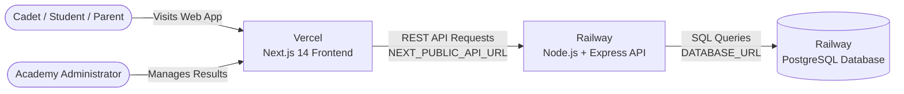

# 🚀 Shivam Academy Result Portal - Full Stack Deployment Guide
### Node.js Backend & PostgreSQL on Railway + Next.js Frontend on Vercel

---

## 🏗️ Architecture Overview



| Component | Technology | Hosting Platform | Key Environment Variables |
| :--- | :--- | :--- | :--- |
| **Frontend** | Next.js 14, React 18, Tailwind CSS | **Vercel** | `NEXT_PUBLIC_API_URL` |
| **Backend API** | Node.js, Express, TypeScript, JWT | **Railway** | `PORT`, `DATABASE_URL`, `JWT_SECRET`, `CORS_ORIGIN` |
| **Database** | PostgreSQL 16 | **Railway** | Automatically provisioned via Railway |

---

## 📦 Project Structure

```text
Shivam-Academy-Result-Portal/
├── app/                          # Next.js App Router (Frontend)
│   ├── page.tsx                  # Student Result Lookup & Top Scorers
│   ├── admin/page.tsx            # Admin Panel (Authentication, Add/Edit/Delete)
│   └── globals.css
├── components/                   # UI Components (TopScorers, etc.)
├── lib/
│   ├── api.ts                    # Unified API Client for Frontend <-> Backend
│   ├── types.ts                  # TypeScript Interfaces
│   └── initialData.ts            # Default Fallback Data
├── backend/                      # Node.js + Express Backend
│   ├── src/
│   │   ├── server.ts             # Express Server & CORS Configuration
│   │   ├── config/db.ts          # PostgreSQL Connection Pool & SSL Handler
│   │   ├── controllers/          # Business Logic (Results, Auth, Stats)
│   │   ├── routes/               # REST API Routes (/api/results, /api/auth)
│   │   ├── middleware/           # JWT Admin Authentication Middleware
│   │   └── db/
│   │       ├── schema.sql        # Database Tables (admin_users, student_results)
│   │       ├── migrate.ts        # Database Migration Runner
│   │       └── seed.ts           # Seeder (Default Admin & Students)
│   ├── Dockerfile                # Production Container definition for Railway
│   ├── package.json
│   ├── tsconfig.json
│   ├── .env.example
│   └── .env
├── .env.local.example            # Frontend environment template
└── RAILWAY_VERCEL_DEPLOYMENT_GUIDE.md
```

---

## 🗄️ PART 1: Deploy PostgreSQL & Backend to Railway

### Step 1: Create a Railway Project
1. Go to **[Railway.app](https://railway.app/)** and sign in with GitHub.
2. Click **"New Project"**.
3. Select **"Provision PostgreSQL"**.
   - Railway will instantly create a managed PostgreSQL database.

---

### Step 2: Add the Node.js Backend Service
1. In your same Railway project, click the **"+ New"** button.
2. Select **"GitHub Repo"** and choose your `Shivam-Academy-Result-Portal` repository.
3. Once the service appears in your dashboard:
   - Click on the newly created service.
   - Go to the **Settings** tab.
   - Find **"Root Directory"** and enter:
     ```text
     /backend
     ```
     *(This tells Railway to build and run the Node.js application inside the `/backend` folder)*.

---

### Step 3: Link PostgreSQL & Configure Environment Variables
1. In your backend service, go to the **Variables** tab.
2. Add the following environment variables:

| Variable Name | Recommended Value | Description |
| :--- | :--- | :--- |
| `DATABASE_URL` | `${{Postgres.DATABASE_URL}}` | Connects directly to the PostgreSQL database in your project. |
| `PORT` | `5000` | Port the backend listens on. |
| `NODE_ENV` | `production` | Enables production optimizations & SSL. |
| `JWT_SECRET` | *(Generate a random 32+ character string)* | Used to sign admin authentication tokens. |
| `CORS_ORIGIN` | `https://*.vercel.app,http://localhost:3000` | Allowed origins (you can update this with your final Vercel domain). |
| `DEFAULT_ADMIN_USERNAME` | `admin` | Initial admin username for seeding. |
| `DEFAULT_ADMIN_PASSWORD` | `admin123` | Initial admin password for seeding (change after first login). |

> [!TIP]
> By using Railway's variable reference `${{Postgres.DATABASE_URL}}`, Railway automatically populates the database credentials and internal hostname without manual copy-pasting.

---

### Step 4: Run Migrations and Seed Database
You can run the schema migration and seeder directly from the Railway dashboard:

1. Click on your **backend service** in Railway.
2. Open the **"Settings"** tab.
3. Under **"Deploy"**, set the **Custom Build Command** (or add a one-off run):
   ```bash
   npm run build && npm run setup
   ```
   *Alternatively*, you can use the **Railway CLI** from your computer:
   ```bash
   railway run npm run setup
   ```
   This executes:
   - `schema.sql`: Creates `admin_users` and `student_results` tables with high-performance indexes.
   - `seed.ts`: Inserts the default administrator and 10 realistic student result records (Aarav Patel, Diya Menon, etc.).

---

### Step 5: Expose Public Domain on Railway
1. In your backend service, click the **Settings** tab.
2. Scroll to the **"Networking"** section.
3. Under **"Public Networking"**, click **"Generate Domain"**.
4. You will get a live public URL like:
   ```text
   https://shivam-academy-backend.up.railway.app
   ```
5. Test it in your browser:
   - Visit `https://shivam-academy-backend.up.railway.app/api/health`
   - You should receive:
     ```json
     {
       "status": "ok",
       "uptime": 12.4,
       "database": "connected"
     }
     ```

---

## ⚡ PART 2: Deploy Next.js Frontend to Vercel

### Step 1: Import Project to Vercel
1. Go to **[Vercel.com](https://vercel.com/)** and sign in with GitHub.
2. Click **"Add New..."** > **"Project"**.
3. Select your `Shivam-Academy-Result-Portal` repository.
4. Leave **Framework Preset** as **Next.js** and **Root Directory** as `./` (default).

---

### Step 2: Configure Environment Variables
In the **Environment Variables** section on Vercel, add:

| Key | Value | Description |
| :--- | :--- | :--- |
| `NEXT_PUBLIC_API_URL` | `https://shivam-academy-backend.up.railway.app` | **Your Railway Backend public URL** (without trailing slash) |

---

### Step 3: Deploy
1. Click **"Deploy"**.
2. Vercel will build and deploy your frontend in ~60 seconds.
3. Once finished, you will receive your live domain, for example:
   ```text
   https://shivam-academy-result-portal.vercel.app
   ```

---

### Step 4: Update Backend CORS
Return to **Railway** > Backend Service > **Variables** tab:
Update `CORS_ORIGIN` to include your new Vercel domain:
```text
CORS_ORIGIN=https://shivam-academy-result-portal.vercel.app,http://localhost:3000
```
*(The backend also automatically allows any `*.vercel.app` domain by default).*

---

## 💻 PART 3: Running Locally

If you want to run both the frontend and backend locally:

### 1. Run the Backend:
```powershell
cd backend
npm install
npm run dev
```
Backend will start on `http://localhost:5000`.

### 2. Run the Database Migrations & Seeder (Local or Remote):
Ensure your `.env` has a valid `DATABASE_URL`, then run:
```powershell
npm run setup
```

### 3. Run the Frontend:
In the root directory:
```powershell
cd ..
npm run dev
```
Open **`http://localhost:3000`** in your browser.

---

## 🔑 Default Credentials & API Reference

### Default Administrator Login:
- **Username:** `admin`
- **Password:** `admin123`

### REST API Endpoints:
| Method | Endpoint | Access | Description |
| :--- | :--- | :--- | :--- |
| `GET` | `/api/health` | Public | System & database health status |
| `GET` | `/api/results` | Public | Fetch all student results (supports `?search=...&subject=...`) |
| `GET` | `/api/results/:id` | Public | Fetch single student result |
| `GET` | `/api/results/stats/overview` | Public | Overall stats (total, pass %, top scorers) |
| `POST` | `/api/auth/login` | Public | Admin login (returns JWT token) |
| `GET` | `/api/auth/me` | Protected | Current admin user profile |
| `POST` | `/api/results` | Protected | Create new student result |
| `PUT` | `/api/results/:id` | Protected | Edit existing student result |
| `DELETE` | `/api/results/:id` | Protected | Delete student result |
| `POST` | `/api/results/bulk` | Protected | Bulk import student results |

---

## 🛠️ Verification & Status Indicators

The frontend includes real-time connection status:
- **🟢 Cloud DB / PostgreSQL Live:** The portal is communicating in real time with your Railway PostgreSQL cloud database.
- **🟡 Local Cache:** When the cloud backend is temporarily unreachable, the frontend automatically falls back to local storage so students never face a blank screen.
